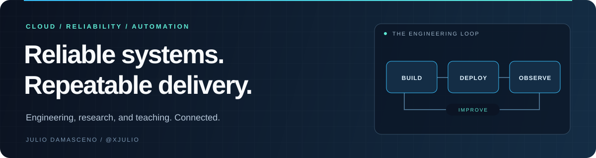

  

<h1 align="center">Julio Damasceno</h1>

  <strong>Lead Site Reliability Engineer at Coupa · Founder of DevOpsHouse · PhD in Cloud Computing</strong>

  I build and operate cloud infrastructure, automate delivery, and help teams understand their production systems.

  
  
  

  <a href="#engineering-focus">Engineering</a> ·
  <a href="#tools-i-work-with">Tools</a> ·
  <a href="#open-source-at-devopshouse">Open source</a> ·
  <a href="#certifications">Certifications</a>

---

## Engineering focus

Over 20 years across engineering, research, consulting, and teaching. My work connects cloud architecture with the day-to-day realities of operating and delivering software.

| Build & deliver | Operate & improve |
| :--- | :--- |
| **Cloud infrastructure** — AWS, Google Cloud, and OCI; Kubernetes environments and cloud adoption. | **Site reliability** — resilient systems, production operations, and practical automation. |
| **Infrastructure as Code & GitOps** — reproducible environments with Terraform, Ansible, and Argo CD. | **Observability** — making system behavior visible and useful for engineering decisions. |
| **CI/CD & tooling** — delivery pipelines, GitHub Actions runners, and tools that reduce manual work. | **Teaching & consulting** — architecture guidance and hands-on cloud and DevOps training. |

## Tools I work with

  

**Also in my workflow:** Argo CD · Oracle Cloud Infrastructure (OCI) · Terramate · Helm

## Open source at DevOpsHouse

Tools built around infrastructure and delivery workflows. Explore the code, open an issue, or contribute.

### [tmswitch](https://github.com/devopshouse/tmswitch)

**Terramate version management.** A CLI that installs and switches between Terramate versions, with support for project version files.

`Go` · `CLI` · `Infrastructure as Code`

### [oci-oidc-auth-config](https://github.com/devopshouse/oci-oidc-auth-config)

**OCI authentication for GitHub Actions.** An action that exchanges a GitHub OIDC token for an OCI session and configures the OCI CLI for subsequent workflow steps.

`GitHub Actions` · `OIDC` · `Oracle Cloud`

### [oci-github-runner](https://github.com/devopshouse/oci-github-runner)

**GitHub Actions runners on OCI.** A runner image for OCI Container Instances with OCI CLI, Ansible, kubectl, Helm, and OCI Vault integration.

`Containers` · `CI/CD` · `Oracle Cloud`

[**View all DevOpsHouse repositories →**](https://github.com/orgs/devopshouse/repositories)

## Certifications

Continuous learning, backed by hands-on credentials.

<a href="https://certdirectory.io/profile/xjulio?utm_source=github&utm_medium=readme">
  <picture>
    <source media="(prefers-color-scheme: dark)" srcset="https://certdirectory.io/badge/xjulio.svg?style=card&theme=dark">
    
  </picture>
</a>

## Beyond the code

Through [DevOpsHouse](https://devopshouse.io/en/), I offer consulting and hands-on training in cloud infrastructure, Kubernetes, infrastructure as code, and software delivery. I bring research and production experience into the same conversation.

**Let's connect:** [LinkedIn](https://www.linkedin.com/in/xjulio/) · [Consulting & training](https://devopshouse.io/en/)

<strong>GitHub activity & statistics</strong>

  <a href="https://github.com/xjulio">
    <picture>
      <source media="(prefers-color-scheme: dark)" srcset="https://github-readme-stats.vercel.app/api?username=xjulio&show_icons=true&hide_border=true&theme=transparent&title_color=58a6ff&text_color=c9d1d9&icon_color=58a6ff">
      
    </picture>
  </a>
  <a href="https://github.com/xjulio">
    <picture>
      <source media="(prefers-color-scheme: dark)" srcset="https://github-readme-stats.vercel.app/api/top-langs/?username=xjulio&layout=compact&hide_border=true&theme=transparent&title_color=58a6ff&text_color=c9d1d9">
      
    </picture>
  </a>

  <a href="https://github.com/xjulio">
    <picture>
      <source media="(prefers-color-scheme: dark)" srcset="https://github-readme-streak-stats.herokuapp.com/?user=xjulio&hide_border=true&background=00000000&ring=58a6ff&fire=58a6ff&currStreakLabel=58a6ff&sideLabels=c9d1d9&currStreakNum=c9d1d9&sideNums=c9d1d9&dates=8b949e">
      
    </picture>
  </a>

  
  

